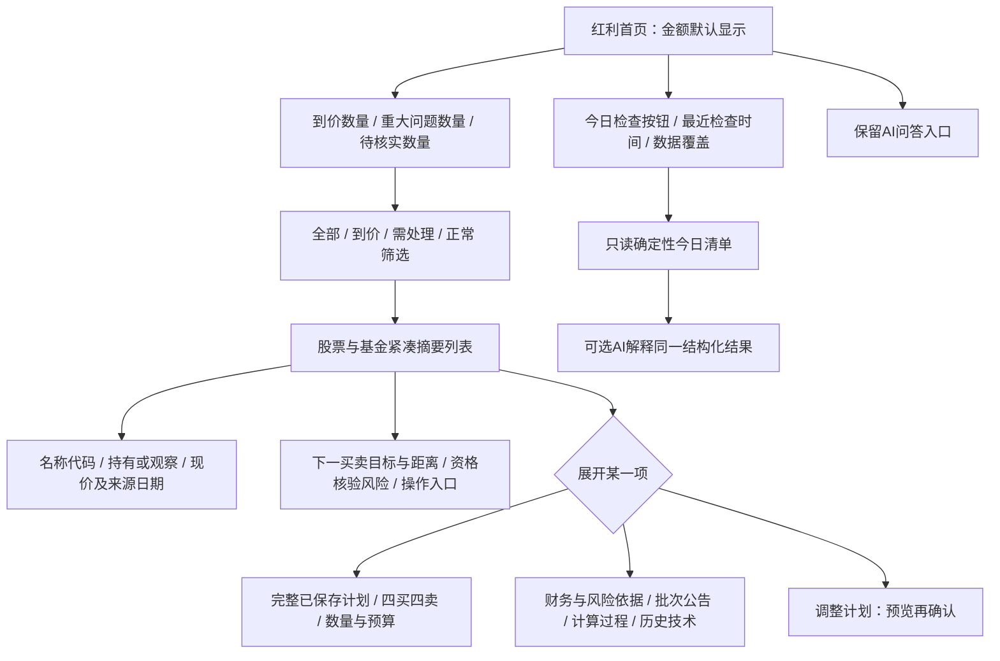

# 阶段 0：界面与数据保全审计

基线：Fortuna 5.0.0，`3163b70ae2add7f00dbc9e01c63f0ab7fa1f2c1f`；审计日期 2026-10-30。

本文件为源码审计与隔离模拟复现，不表示真实设备、真实报价、真实持仓或接口完整性验证。本阶段没有修改生产代码、版本号、数据库 schema 或用户数据。计算依据为 `docs/dividend-pricing-method.md` 2026-10-30 的最近已实施分红批次规则。

## 结论

手机页面过长有明确的结构原因：股票卡的折叠区域没有包含实际买卖计划；基金卡也始终平铺各项指标。金额独立默认显示已符合任务书，应保留。已有价格确认通道对真实账本、预算、暂停与持仓有较好的字段边界和并发保护；普通股票编辑通道仍存在旧表单覆盖较新计划的缺口。基金没有套用股票股息率公式，但同日手工参考价格会被当作可用价格触发，需要把“观察参考”与“可成交行情”分开。

## 手机浏览器基线

主审计在全新隔离 Chrome profile 中放入十只模拟股票和两只模拟基金，屏蔽真实行情、公告和外部AI，记录 [browser-baseline.json](browser-baseline.json)。这是浏览器手机尺寸验证，不是真机/安卓模拟器安装证明。无页面错误，以下各尺寸均未发现横向溢出；纵向扫描成本仍很高。

| 宽度 / 字号 | 十张卡展开合计高度 | 十张卡收起合计高度 | 收起后仍显示的买卖表 |
| --- | --- | --- | --- |
| 390px / 1× | 10,942px | 9,466px | 20 张 |
| 320px / 1× | 11,052px | 9,576px | 20 张 |
| 390px / 1.3× | 未另测展开 | 12,670px | 20 张 |
| 320px / 1.3× | 未另测展开 | 13,292px | 20 张 |

390px/1×收起只缩短 13.49%，未满足“十只全部收起时明显缩短”的目标。截图：[390px 单卡收起](stock-card-390-collapsed.png)、[320px 单卡收起](stock-card-320-collapsed.png)、[320px 放大字号的收起列表](stocks-320-collapsed-font130.png)。资产页全局金额隐藏时，红利金额仍默认显示，验证符合要求。无 AI 配置点击今日建议会打开配置，确定性清单数量为 0，截图：[点击后配置页](daily-no-ai-opens-settings-320.png)；该问题由风险审计详细展开。

## 已复现的问题

所有复现命令：`node docs/dividend-stage0/reproduce-ui-data.ts`。脚本使用进程内 `fake-indexeddb`，没有打开浏览器或设备数据库；输出为同目录 `ui-data-reproduction.json`。输出记录缺陷现状，不代表修复验收已通过。

| 编号 / 优先级 | 当前行为及证据 | 影响和最小修复方向 |
| --- | --- | --- |
| UI-COLLAPSE-01 / P1 | `DividendPage.tsx:238-240` 在 `hidden={!expanded}` 的 body 前渲染 `DividendHomePlan`。后者 `:21-27` 始终渲染两侧完整表。`scripts/dividendHomePlan.test.ts:38-48` 还明确要求“不展开也显示全部档位”，旧浏览器验收亦要求折叠后计划仍可见。 | 收起十只股票，仍保留全部买卖表、预算、来源与说明，无法明显缩短页面。阶段 2 将完整计划连同其他明细纳入真正折叠体；折叠后保留当前价、下一买卖档、日期、风险/核验摘要和入口。更新旧测试的验收目标；不改价格。 |
| UI-DATA-02 / P1 | `StockEditor` 在 `DividendPage.tsx:304` 复制打开时记录；`:321` 保存整个旧对象。`saveDividendStock` 在 `dividendService.ts:45-53` 仅合并最新行情/分红/趋势，其他字段按旧对象 `put`。模拟中旧买价 1000 分、未暂停、100 股；另一写入改成 900 分、暂停、200 股；旧表单只改备注并保存后恢复 1000 分、未暂停、100 股，且来源被清掉。 | 有条件的并发数据覆盖缺陷；单窗口正常顺序操作不一定遇到。应给编辑器保存加初始指纹/版本比较，或显式提交已编辑字段；冲突保留较新记录并让用户重新打开。不得用显示改造顺便改写历史计划。该修复不改变定价方法，建议作为独立数据安全修复提交。 |
| UI-FUND-01 / P1 | `dividendFundPlan.ts:87-105` 没有 `fund.quote` 时回退到 `reference.priceMicros`，只要 `reference.asOf` 是今天即为 `priceCurrent`；`:129-131` 卖出亦如此。模拟 ETF 无行情，手工价格 1.00 元、前高 1.20 元、指数股息率 5.5%，显示入场 `met`；手工价格改成 1.20 元显示卖出 `triggered`。 | 手工观察值虽显示来源，仍混入“当前价格条件已满足”。保留基金原有回撤/指数股息率/前高算法，以来源种类区分观察条件与执行资格；没有适用行情时 `actionCheck` 必须待行情确认。不得把手工参考或旧净值称为最新可成交行情。 |
| UI-GRID-01 / P1 | `DividendHomePlan.tsx:15` 调用 `reviewDividendGrid` 不传当前税率，`:29` 调用 `DividendGridOrigin` 也未传。税变检查仅在 `dividendGridProvenance.ts:65` 的 `options.taxBps !== undefined` 时发生。相同模拟基数、旧税率 10%、当前税率 20%，现首页调用仍为 `verified`；补足税率参数后为 `saved_unverified / tax_changed`。 | 首页与选股详情可能显示不同的网格有效性。阶段 1 统一摘要从当前方法得到税率，各处读取同一结果；历史价格保持原值，只增加过期说明。这是已存在规则的漏传修复，不是变更税率规则。 |
| UI-LOAD-01 / P2 | `DividendPage.tsx:58-61` 等待所有 basis 后才 `setData`；`dividendGridBasisService.ts:9-18` 对全部证券用 `Promise.all`，没有逐项容错；`dividendLedgerEvidenceService.ts:129` 直接返回存储对象，没有验证。模拟两只证券，其中一只 ledger 缺少 `events`，整批抛出 `TypeError`。初次加载退化为 `DividendPage.tsx:117` 的全页错误文字。 | 单一损坏/不兼容缓存可阻止其他计划展示。阶段 1 将单项异常转换为该证券的 `unknown` 和可重试原因；整体储存不可读则明确整库故障。不得静默删除损坏记录，也不得清库重试。普通网络单项失败已有独立处理，不能把此项误说成所有接口失败都会全页空白。 |
| UI-DATA-03 / P3 | 隔离模拟 JSON 导出恢复保留完整 settings；Excel 恢复保留模拟股价计划、预算、手动持仓和暂停，但丢失 `dividendHomeCollapsedCodes`。字段存在于 `db.ts:165`，Excel 还原对象 `:863-888` 未读回它。 | 丢失的是阅读偏好，不是资金/持仓。阶段 2 如仍沿用此偏好，只修 Excel 字段往返；不要为此迁移真实账本 schema。 |

## 已核实应保留的行为

1. **金额默认显示且独立**：`DividendPage.tsx:25` 用组件本地 `useState(true)`，`:214` 手动切换，不读取资产页 `settings.amountVisible`。手动隐藏仅当前组件会话生效，离开重进恢复显示。任务书要求是否延续会话记忆再确认，本阶段原样保留。
2. **保存计划优先于新计算覆盖**：`dividendWorkbench.ts:191` 优先使用显式 `priceMinor`；`reviewDividendGrid` 是纯只读函数（`dividendGridProvenance.ts:40-91`）；过期结果不会自动写回网格。没有来源的旧网格显示“基数未核对”，不自动伪造来源。
3. **数值计划的预览只读**：`dividendAdvisorActionsService.ts:95-107` 使用只读事务；`DividendAdvisorPlanActions.tsx:51-59` 的确认仍先调用证据检查，再应用指纹。`:89-93` 指纹绑定网格、暂停、权重、手动股数、DPS、整手、来源、草案、方法和日期；`:125-135` 事务仅写提案指定字段。
4. **用户持仓和预算不由价格提案改写**：数值确认仅替换四买四卖和来源，除非明确暂停提案才写 `buyPaused`。测试 `scripts/dividendGridPersistence.test.ts:73-93` 对比全库并验证 JSON/Excel，`:110-121` 拒绝来源变化后的旧确认；`scripts/dividendAdvisorActions.test.ts:233-267` 覆盖预览后计划/参数/日期变化。普通编辑器的并发缺口见上表，不能用这些确认通道的测试替它背书。
5. **保留手动暂停与恢复确认**：`buildDividendHomePlan` 在 `dividendWorkbench.ts:217` 先返回 `paused`；价格触发仍可独立显示。恢复入口 `DividendAdvisorResumeReview.tsx:35-38` 要求阅读勾选后再预览/确认。风险检查不得自行将 `buyPaused` 设为 false。
6. **行情写入合并最新记录**：`dividendQuoteService.ts:43-59` 只更新 quote/失败时间，基金还校验当前 id/code；不会用请求前的整份设置覆盖新的计划。`dividendService.ts:172-185` 对行情、公告失败只标失败时间，不删除原有效数据。
7. **资产/账户关联维持原有设计**：`linkedDividendPositions` 在 `dividendWorkbench.ts:124-138` 只读取有效 CNY 股票组合账户、持仓与交易并按代码聚合。红利列表、摘要、折叠无须改动 `Account`、`Holding`、`HoldingTxn`、`PlanItem/PlanTarget` 或现有资产类型/账户视图。
8. **基金算法独立**：`dividendFundPlan.ts:94-121` 使用回撤、指数股息率和 both/either；`:125-133` 按 hold/rebalance/swing 产生各自退出说明，没有导入股票 DPS÷收益率公式。高点作为固定比较点，与价格、股息率观察日期分开解释；不为高点任意增加新过期阈值。
9. **危险删除已有保护**：`dividendAdvisorActionsService.ts:149-165` 连隐藏/归档账户的持仓与未来买入都保护，删除前在事务中复核；普通删除 `dividendService.ts:64-76` 同样拒删持仓股。此次 UI 不应默认移除失败证券。

## 数据保全与可追溯边界

主库当前是 `AssetManagerDB`，schema 到 11（`db.ts:331-332`）。完整 JSON 的逻辑版本是 14（`:499`），Excel 元数据版本是 6（`:562`），这些数字是不同概念，不可混改。红利模块来源字段位于股票对象内，作为 `DividendStocks` 整体 JSON 写入 Excel（`:657`），故现有来源随 JSON/Excel 保留。

`readBackupTables` 在单一只读事务读取账户、记录、汇率、设置、产品、配置计划、持仓、交易、红利股票与监控（`db.ts:486-495`）。JSON/Excel 恢复是用户主动触发的全量替换事务（`:512-536`、`:969-989`）；不能拿“恢复演示数据”做本次真实设备验证。

独立 `FortunaDividendLedger`、研究缓存、每日建议、聊天、AI配置不在这些主库备份表内。已保存网格的来源目前只留生成时间、总税前DPS、税率、计算版本、基数种类（`dividendGridProvenance.ts:4-9`），不包含选中批次、公告URL/PDF hash。恢复后仍可复算价格算术，但不足以重放原来是哪两份公告。这是来源证据保全缺口；见定价审计提出的方案，阶段 1 不擅自扩展真实账本 schema，不回填未知历史来源。

## 手机信息架构（设计，未实现）

选股单项第一屏顺序固定：①资格与最多三条核心原因；②可信网格（最新核验或历史保存，标清状态）、现价、下一档、收益率、税前税后基数与日期；③操作约束。证据只在单个展开区，不能同时在摘要、风险卡、逐项指标与价格说明重复铺满。

不采用“每股默认永远展开”的兼容方案。旧偏好可作为页面恢复状态，但首次改版默认折叠，且折叠应真正移除表格占据的高度。不能为了页面短而移除安全校验或漏掉失败证券。

## 后续阶段的最小分工

| 阶段 | 修改范围 | 必须验证 | 不包含 |
| --- | --- | --- | --- |
| 1：统一只读状态 | 以现有服务/纯函数为基础，集中产出 eligibility/grid/trigger/risk/actionCheck/freshness；传入当前方法税率；单项失败隔离。分别展示最后可用报价和“今日适用”状态；旧价格不覆盖。 | 同一输入在首页/详情/今日清单一致；资格失败+到价同屏显示；缺数据保留历史价；税变识别；无AI仍有检查；单项缓存坏不影响其他项；输入和全库快照检查前后相等。 | 不改变股息率、频率、税、取整、>25%交叉检查、原网格价格、真实账本schema；不自动暂停。 |
| 独立安全修复 | UI-DATA-02 并发编辑冲突保护，单独提交与回退。 | 用旧编辑器保存备注不能恢复旧网格/暂停/股数；正常修改仍可保存；行情新值保留。 | 不借机重做编辑器或账本。 |
| 2：页面结构 | 将整份计划纳入真实折叠；股票基金统一列表；检查入口前置，摘要数量和筛选，详细数据下沉。 | 320/390px、1×/1.3×字体；十股票折叠高度明显下降；公共价与用户金额隐藏边界；金额默认显示独立；首屏所有关键入口可用；单只失败可重试；资产类型/账户视图原样。 | 不改基金公式和股票公式；不写真实数据库作展示测试。 |
| 3：今日检查 | 在已有 prepareDividendAdvisorContext/fetchDividendResearch 上组织阶段进度、失败项重试、取消与超时；先展示阶段 1 确定性清单，再可选AI归纳。 | 无AI/请求失败/取消后清单保留；旧证据日期不刷新；旧行情不写今日已可执行；AI不能覆盖结构化状态；检查不写网格，确认才能写。 | 不新建第二套研究/报价/风控引擎；不自动交易、后端或自动上传。 |

如要从“风险只提示”升级为某些风险阻断新增，先列明规则ID、适用条件、阈值来源和影响，交用户确认。现有参数默认值、持仓假设与基金 either/both 不因显示重排而改变。

## 每阶段的回退和交付

每阶段只包含该阶段文件，记录修改前 commit、修改文件、行为前后对比、测试命令/输出、手机截图和真实/模拟边界。验证 `npm test`、`npm run lint`、`npm run build`；回退只回退该阶段代码提交，不导入旧备份、不降低数据库版本、不覆盖当前账本。审计分支的文档可独立撤回，现有生产行为保持不变。主报告负责统一记录本次执行得到的测试总数与手机截图；本文件不沿用 v5 发布记录充当新验证。
